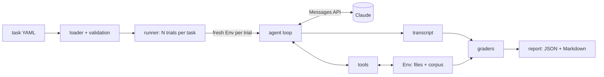

# agent-eval-harness: design

| | |
|---|---|
| **Author** | Justin Cassar |
| **Status** | v1 in progress |
| **Last updated** | 2026-10-26 |

## Summary

A Go harness that runs a Claude agent through YAML-defined tasks in isolated, in-memory environments. Each trial is graded separately on its answer, the workspace it leaves behind and the tools it called. Each task runs several times so reliability (pass^k) can be reported alongside capability (pass@k). Everything is deterministic and can be tested offline. LLM-as-judge grading, real sandboxes and other providers are deferred.

**Contents:** [Background](#background) · [Goals and non-goals](#goals-and-non-goals) · [Requirements](#requirements) · [Design](#design) · [Alternatives considered](#alternatives-considered) · [Cross-cutting concerns](#cross-cutting-concerns) · [Known limitations](#known-limitations) · [Open questions](#open-questions) · [Testing](#testing) · [Implementation plan](#implementation-plan)

## Background

Most LLM eval setups score one response against a reference answer. That works for a chatbot but not really for an agent. An agent makes a series of tool calls and changes things along the way, and there are lots of ways to get to the right answer, some of them bad. If it gets the right number but took twelve tool calls to do it, or rewrote a file it was told not to touch, a check on the final answer alone would still pass it.

The other problem is that agents aren't deterministic. Running each task once tells you whether the agent *can* do it, not whether it does it reliably, and reliability is usually what matters.

So for a given setup (model, effort level, system prompt) I want to know:

- is the answer right
- is the workspace in the state it should be afterwards
- did it take a reasonable path to get there
- how often does all of that hold across repeated runs
- what did it cost in tokens, money and time

## Goals and non-goals

### Goals for v1

- grading the answer, the end state and the tool-call trajectory separately, so a failed trial tells you which part failed
- running each task several times and reporting reliability, not just a pass rate
- tasks defined in YAML, so adding one doesn't need Go code
- saving the full trace of every trial (each model turn, tool call, result and token count)
- tests that run offline without an API key
- a CLI that can fail a CI build below a minimum pass rate

### Non-goals, at least for now

- Other model providers. It only evaluates Claude agents. There's an `Agent` interface so another provider could be added later, but I'm not building one yet.
- Real sandboxes (shell, containers, network). Environments are in memory, which rules out coding-agent tasks like SWE-bench for now.
- A UI. Output is JSON plus a Markdown summary.

## Requirements

A few things the design has to get right:

1. Each trial runs in its own copy of the task's environment. Trials run in parallel, so they can't share state, and a failure should be reproducible by rerunning the same task.
2. A trial passes only if every grader passes. Getting the right answer while breaking something else counts as a fail.
3. API errors and timeouts are tracked separately from the agent failing. Otherwise an outage looks like a regression.
4. Task files get validated before any API calls are made, so a typo in a spec fails straight away instead of after you've paid for a run.
5. Each task has a turn limit, so a looping agent stops eventually. Hitting the limit is reported as its own outcome.
6. When a tool call fails, the error goes back to the model as a tool result instead of ending the trial. Recovering from errors is part of what's being tested.
7. Token usage is recorded on every turn so runs can be costed.
8. No test needs network access.

## Design

### Overview

The runner loads the tasks, then for each trial creates a fresh environment and hands it to the agent. The agent goes back and forth with the model and the tools until it's done or out of turns, and produces a transcript. Graders look at the transcript and the final state of the environment, and the report aggregates everything.

### Packages

- `tools`: the `Tool` interface, the per-trial `Env`, and the built-in tools
- `task`: task spec, loading and validation
- `agent`: the `Agent` interface, transcript types and the Claude agent
- `grader`: the graders
- `runner`: concurrent trials and the pass@k / pass^k maths
- `report`: aggregation, pricing, JSON and Markdown output
- `cmd/evalh`: the CLI

Each package only depends on the ones above it in that list, so they can be built and tested in that order.

### Tasks

A task is a YAML file with an id, a prompt, optionally some extra system prompt, the tools the agent gets, a turn limit, the starting files and search documents, and the graders.

Decoding is strict, so unknown keys are an error. I mainly wanted this because of one failure mode: if you misspell `graders`, a lenient decoder drops it, the task runs with no graders, and it passes every time without anyone noticing.

Several tasks can share a search corpus through a `corpus:` path. The loader skips directories starting with `_`, so shared files can live in the tasks folder.

### Environments and tools

The `Env` is an in-memory map of files plus a list of documents, copied fresh from the task for each trial. Tools take the env and their input and return a string. They don't touch anything else.

v1 has five tools: `calculator`, `list_files`, `read_file`, `write_file` and `search_docs` (basic keyword search). They're simple on purpose. The tools themselves aren't the point; what matters is what they let me test. Does the agent use the calculator instead of doing arithmetic in its head? Does it look around before reading files? Can it edit a file without wrecking the rest of it, combine facts from two documents, and admit when the answer isn't there?

Tool schemas are sent in strict mode and inputs are decoded with unknown fields rejected, so a bad call comes back as a clear error.

### The agent loop

The loop is the standard one: send the conversation and tools, append the model's full response to the history unchanged, run whatever tools it asked for and send all the results back in one message, and repeat until it stops calling tools or hits the turn limit. Each model call and tool call is timed, and usage is recorded per turn.

The system prompt asks the model to finish with a `FINAL ANSWER:` line. Graders read whatever comes after the last one, or the whole last message if there isn't one.

### Graders

There are three kinds:

- outcome (`final_answer_contains`, `final_answer_regex`, `final_answer_numeric`), which check the answer
- state (`file_contains`, `file_unchanged`), which check the files after the run
- trajectory (`tool_called`, `tool_not_called`, `tool_sequence`, `max_tool_calls`), which check which tools were called and in what order

They're all deterministic for v1. Each one returns a short explanation along with pass/fail, e.g. `want 74.12 ± 0.01, got 74.11`, so you can usually see why something failed from the report without digging through the trace.

### Metrics

For a task with $n$ graded trials and $c$ passes:

| Metric | Question | Formula | Source |
|---|---|---|---|
| pass@1 | How often does a single trial pass? | $c / n$ | |
| pass@k | Does at least one of $k$ trials pass? | $1 - \binom{n-c}{k} / \binom{n}{k}$ | [Chen et al., 2021](https://arxiv.org/abs/2107.03374) (unbiased estimator) |
| pass^k | Do all $k$ trials pass? | $\binom{c}{k} / \binom{n}{k}$ | [Yao et al., 2024](https://arxiv.org/abs/2406.12045) (τ-bench) |

I report both with k = n. pass^k is the one I care about more. If a task has a pass@3 of 100% and a pass^3 of 33%, the agent can clearly do it, it just doesn't do it every time.

Each trial ends up passed, failed or errored. Errored means the API call failed or the trial timed out, so it says nothing about the agent. Errored trials are left out of pass rates and listed separately.

## Alternatives considered

**Go rather than Python.** Python is the obvious choice for ML tooling and has more eval libraries. But this is mostly orchestration code (running trials concurrently, timeouts, parsing specs, writing reports), and Go is good at that. Goroutines make the worker pool easy, the type checker catches mismatches between specs and transcripts, and it builds to a single binary that's easy to run in CI. The downside is writing some things myself, like the expression parser for the calculator.

**Writing the agent loop instead of using the SDK's tool runner.** The SDK can run the tool loop for you, and in an app I'd use that. Here the loop is the thing being measured. I need per-call timing, a per-task turn limit, every intermediate step recorded, and control over what goes into the history. It's about a hundred lines, which seems worth it.

**YAML tasks rather than Go.** Tasks written in Go could have arbitrary grading logic. With YAML, anyone can add a task, tasks are easy to review in a diff, and graders have to be reusable. If a task needs something new, that becomes a new grader type.

**In-memory environments rather than temp dirs or containers.** A real filesystem or container would let me test shell and coding tasks. In-memory is fast, safe to run in parallel and deterministic, and the agent can't get out of it. I'm OK with the limitation for v1.

**No LLM-as-judge yet.** Having a model grade answers against a rubric works better for open-ended answers, but it costs money, adds variance, and the judge makes mistakes of its own. Starting with deterministic graders keeps scores free and reproducible. The unanswerable-question task is where I expect to need a judge first, since the regex for "I couldn't find it" is fragile.

**Refusal fallback turned off.** The API can automatically send a refused request to a different model. That's useful in production, but in an eval it would quietly mix two models' results into one score. Refusals are recorded as their own stop reason instead.

**Errored trials left out of pass rates.** Counting them as failures makes outages look like regressions. Leaving them out could hide a config that's broken, so the report always shows the errored count next to the pass rate. I'm not completely sure this is right. If a model times out a lot on one task, that's arguably a real failure, but for now a timeout counts as errored.

## Cross-cutting concerns

**Isolation and safety.** The agent only acts through the tools it's given, and the tools only touch the trial's in-memory `Env`. It has no shell, no network access and no access to the host filesystem, so a misbehaving agent can't affect the machine running the eval or other trials.

**Cost.** Task specs and graders are validated before the first API call, so a broken spec costs nothing. Every turn's token usage is recorded and priced, and the turn limit caps what a looping agent can spend.

**Observability.** Every trial's full transcript is saved to `results.json`, and every grader explains its verdict, so a failure can be diagnosed from the report and then checked against the trace.

**Credentials.** The API key is read from the environment or an `ant auth login` profile by the SDK. It is never written to results or reports.

## Known limitations

- The example suite is small. 9 tasks × 3 trials is 27 trials, and at that size the 95% confidence interval on a 50% pass rate is about ±19 points, so small differences between runs don't mean much. Confidence intervals are on the list. Until then, compare runs task by task.
- Graders can be wrong, especially the regex ones. Every grader explains its verdict and the full trace is saved, so verdicts can be checked.
- Nine hand-written tasks don't measure general agent quality. They're there to exercise each type of grader.
- Prices are hard-coded and will go out of date. A model that isn't in the table shows no cost rather than a wrong one.

## Open questions

- Should the agent be told its turn limit? Right now it isn't, so running out of turns comes as a surprise. Telling it would be more realistic for some uses, but it changes what's being measured.
- Effort defaults to medium. I haven't checked yet whether higher effort changes results on tasks this small.
- The overall pass rate is pooled across all trials, so a task with more trials counts for more. That's fine while every task gets the same number of trials, but it would need changing if that stops being true.

## Testing

- Unit tests for each package: the calculator parser, each tool, each grader, task validation, and the pass@k / pass^k functions.
- The Claude agent is tested against an `httptest` server that returns canned API responses and records what it was sent. That checks the real request format (tool results, strict schemas, effort) without a network connection.
- One test loads the example tasks and fails if any are invalid, so they can't quietly break.
- CI runs gofmt, go vet, the tests with the race detector, and `evalh validate`.

## Implementation plan

1. Tools and environments
2. Task specs and example tasks
3. The agent loop
4. Graders
5. Runner
6. Reports and CLI
7. CI and docs

After that: comparing two runs (`evalh compare`), an LLM-as-judge grader, confidence intervals, an HTML trace viewer, and more kinds of environment.
